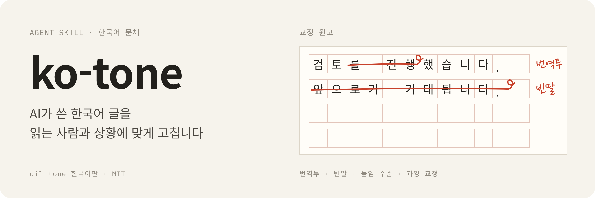

<p align="center">
  
</p>

AI가 쓴 한국어 글을 읽는 사람과 상황에 맞게 자연스럽게 고치는 Agent Skill입니다. 중국어·영어용 문체 규범 [oil-tone](https://github.com/oil-oil/oil-tone)을 한국어에 맞게 다시 설계했습니다.

목표는 문장을 무조건 짧게 줄이는 것이 아니라, 읽는 사람이 한 번에 이해하는 글입니다. AI 티를 지우다가 조사와 어미까지 깎아 전보처럼 만드는 것도 실패로 봅니다. 원문의 사실, 수치, 확신 정도는 바꾸지 않습니다.

## 고치는 예

| 원문 | ko-tone의 처리 |
| --- | --- |
| `가스비 최적화: 작은 차이가 만드는 큰 변화` | `가스비를 줄인 방법` |
| `코드 리뷰를 진행했습니다` | `코드를 리뷰했습니다` |
| `이것은 단순한 지갑이 아니라 새로운 금융 경험입니다` | 지갑이 실제로 하는 일을 바로 씁니다 |
| `앞으로의 행보가 더욱 기대됩니다` | 내용이 끝나면 그대로 끝냅니다 |
| `배포 완료. 이슈 없음. 모니터링 중.` (블로그 글에서) | `배포를 마쳤고 지금까지 이슈는 없습니다. 당분간 모니터링하겠습니다.` |

마지막 예처럼 짧게 줄이는 것이 늘 정답은 아닙니다. 조사와 연결어미가 문장 사이의 관계를 실어 나르기 때문에, 그것까지 지우면 오히려 읽기 어려워집니다.

## 무엇을 보나

- **사실**: 경험, 수치, 사용자 반응을 지어내지 않았는지, 원문의 확신 정도를 올리거나 내리지 않았는지
- **상황과 높임 수준**: 사내 보고, 업무 메신저, 이메일, 기술 문서, PR·커밋, 블로그, 발표 대본, 대외 공지, SNS 가운데 어디에 쓰는 글인지 정하고, 합쇼체·해요체·평어체·개조식 가운데 하나로 통일했는지
- **번역투**: `~에 있어서`, `~에 의해`, `검토를 진행했습니다`, `회의를 가졌습니다`, `되어지다`
- **빈말**: 시대 배경으로 여는 첫 문장, `전문가들은` 같은 모호한 출처, 홍보 문구, `앞으로가 기대됩니다` 같은 결말
- **AI 수사 습관**: `단순한 X가 아니라 Y`, 콜론 제목, 질문형 전환, 줄표, 이모지 불릿
- **과잉 교정**: 조사와 어미를 깎은 전보체, 인과가 끊긴 짧은 문장, 모든 문단을 개조식으로 쪼갠 글
- **용어와 표기**: 원어로 통용되는 기술 용어 유지, 영문 뒤 조사(`EIP-4337을`), `을(를)` 같은 조사 병기

## 설치

### claude.ai, Claude 데스크톱 앱

1. [Releases](https://github.com/jaejeonglee/ko-tone/releases)에서 `ko-tone.zip`을 받습니다. GitHub의 "Download ZIP"으로 받은 파일은 폴더가 한 겹 더 있어서 그대로 올리면 인식되지 않습니다.
2. Customize → Skills → `+` → Create skill → Upload a skill에서 올립니다.

claude.ai 계정에 등록한 스킬은 같은 계정으로 로그인한 Claude Code에도 동기화됩니다.

### Claude Code

```bash
git clone https://github.com/jaejeonglee/ko-tone.git
cp -R ko-tone/skills/ko-tone ~/.claude/skills/ko-tone
```

팀 저장소에서 함께 쓰려면 `skills/ko-tone` 폴더를 그 저장소의 `.claude/skills/ko-tone`에 넣고 커밋합니다.

## 사용

"자연스럽게 다듬어줘", "AI 티 빼줘", "번역투 고쳐줘"처럼 말하면 스킬이 실행됩니다. 어디에 쓸 글인지 함께 알려 주면 더 정확합니다.

```text
ko-tone으로 이 공지 다듬어 줘. 디스코드 커뮤니티에 올릴 메인넷 업그레이드 안내야.
```

```text
이 주간 보고 AI 티 빼 줘. 팀장님께 보내는 거고 개조식으로.
```

```text
README 초안인데 번역투만 고쳐 줘. 명령어와 옵션 이름은 건드리지 마.
```

상황을 말하지 않으면 원문을 보고 추정하고, 추정한 상황을 결과 맨 위에 한 줄로 밝힙니다.

## 검사 스크립트

표준 라이브러리만 쓰는 검사 스크립트가 들어 있습니다. 다시 볼 만한 표현을 `WARN`으로 알려 줄 뿐, 고칠지는 정하지 않습니다.

```bash
python3 skills/ko-tone/scripts/ko_tone_lint.py draft.md
python3 skills/ko-tone/scripts/ko_tone_lint.py --self-test
```

줄 단위 규칙 27개와 문서 단위 점검 2개(높임 수준 혼용, 같은 종결 3문장 연속)가 있습니다. 코드 블록과 인라인 코드는 검사하지 않습니다. 경고가 없다고 자연스러운 글이라는 뜻은 아닙니다. 스크립트는 사실이 맞는지도, 글이 자연스러운지도 판단하지 못합니다.

## 저장소 구조

```text
ko-tone/
├── skills/ko-tone/
│   ├── SKILL.md                  # 핵심 원칙, 작업 순서, 완성 점검
│   ├── references/contexts.md    # 상황별 높임 수준, 구성, 피할 표현
│   ├── references/patterns.md    # 패턴 목록과 고친 예
│   ├── scripts/ko_tone_lint.py   # 검사 스크립트
│   └── NOTICE.md                 # oil-tone 출처와 라이선스
├── assets/readme/                # README 배너 (hero.html을 render.js로 렌더링)
├── LICENSE
└── README.md
```

## 팀 문체에 맞추기

fork한 뒤 `skills/ko-tone/references/contexts.md`에 팀 보고서 양식, 메신저 관행, 쓰지 않을 표현을 적으면 됩니다. 스킬은 이 가이드보다 조직의 기존 관행을 먼저 따르도록 되어 있습니다.

## 기여

자주 보이는 AI 문체를 발견하면 Issue나 PR로 알려 주세요. 아래 네 가지를 함께 적어 주시면, 예문 하나를 고치려다 다른 글을 망가뜨리는 규칙이 생기는 것을 막을 수 있습니다.

1. 원문
2. 무엇이 문제인지
3. 더 자연스럽고 정확한 고친 문장
4. 이 규칙이 맞는 경우와 맞지 않는 경우

## 출처와 라이선스

[oil-tone](https://github.com/oil-oil/oil-tone)(oil-oil, MIT)의 원칙과 구조를 바탕으로 한 파생 작업입니다. 라이선스는 [MIT](./LICENSE)입니다.
